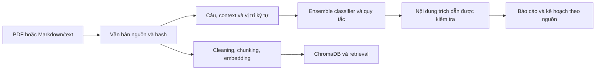

# PSAI — phân tích tài liệu đề xuất dự án

**Dành cho người nhận dự án:** bản clone chạy được demo Markdown ở chế độ **fast** với Python 3.11 trở lên, không cần model, GPU, API key hoặc `pip install`. Chế độ **full** dùng model thật và cần chuẩn bị model/dependency riêng. Fast là luồng quy tắc + BM25 + kế hoạch theo bằng chứng.

| Bạn muốn làm gì? | Bắt đầu tại đây |
|---|---|
| Đọc code và đánh giá | [Hướng dẫn review](docs/REVIEW_GUIDE.md) |
| Chuẩn bị thuyết trình và demo | [Kịch bản 8–10 slide](docs/PRESENTATION_GUIDE.md) |
| Dùng giao diện Chrome/Edge | [Cài extension](README_EXTENSION.md) |
| Chạy model AI đầy đủ | [Thiết lập full trên máy nhận](docs/FULL_RUNTIME_SETUP.md) |
| Xem kết quả mẫu | [Bản demo bàn giao](docs/demo/README.md) |

## Clone và chạy ngay

```sh
git clone https://github.com/Binh511/DSP-project.git
cd DSP-project
python tools/demo_project.py --fast
```

Trên máy dùng lệnh `python3`, thay `python` bằng `python3`. Lệnh in đường dẫn thư mục output mới; mở `report.html` và `workspace.html` trong thư mục đó. Bấm một dẫn chứng trong báo cáo để đối chiếu đoạn nguồn. Trong workspace, đổi trạng thái công việc và xuất JSON tiến độ để lưu. Mỗi lượt tạo một thư mục mới, không ghi đè kết quả cũ.

Thử tài liệu Markdown/TXT UTF-8 của bạn:

```sh
python tools/demo_project.py --fast --input examples/proposal.md
```

Với giao diện extension, chạy `python -m psai_extension`, giữ terminal mở rồi thực hiện [các bước cài Chrome/Edge](README_EXTENSION.md). Khi chưa có model, chọn **Chạy nhanh**. PDF cần thêm dependency; xem [OCR](psai_ocr/README.md).

## Kiểm tra trên máy nhận

Kiểm tra CLI và API thực tế trong bản source tạm và venv trống, không tải model hoặc cài thư viện ML:

```sh
python tools/verify_clean_clone.py
python -m unittest discover -s tests -p test_extension_backend.py -v
```

Kiểm tra logic extension với Node.js 22 trở lên, không cần npm:

```sh
node --test extension/psai/tests/core.test.mjs
```

[GitHub Actions](.github/workflows/verify.yml) chạy kiểm tra fast trên Python 3.11/3.13 và lưu artifact bằng chứng. Xem trạng thái của commit hiện tại trong tab **Actions**. Các số liệu kiểm thử ở phần dưới và trong báo cáo lịch sử thuộc những lần chạy đã được ghi nhận; không thay thế việc kiểm tra commit bạn đang review.

Bản GitHub chứa mã nguồn, test, tài liệu, đầu vào tự tạo và báo cáo được chọn. Model weights, môi trường ảo, tài liệu gốc, dữ liệu/nhãn nghiên cứu và output cá nhân được chuyển riêng. Muốn chạy full hoặc tái lập nghiên cứu, xem [checklist tài nguyên](docs/FULL_RUNTIME_SETUP.md).

PSAI trích thông tin từ văn bản đề xuất, phân loại câu vào năm nhãn và tạo báo cáo/kế hoạch có dẫn lại đoạn nguồn. Nhánh retrieval bổ sung tìm kiếm các đoạn bằng embedding. Đây là hệ thống nghiên cứu; việc nội dung có trích dẫn không tự chứng minh nhãn đúng hoặc thông tin trích xuất đã đầy đủ.

## Chạy nhanh

Bản extension Chrome/Edge v0.1.0 đã có giao diện tải tài liệu và kết nối backend Python cục bộ. Xem [cài extension và chạy backend](README_EXTENSION.md); mã extension nằm trong [extension/psai](extension/psai/). Gói ZIP được tạo bằng `python tools/package_extension.py`.

Điểm vào cho toàn bộ luồng mới:

```powershell
python tools/demo_project.py
```

Lệnh chạy OCR khi cần, classifier thật, hybrid RAG, LLM cục bộ và tạo workspace. Xem [hướng dẫn toàn project](README_PROJECT.md), [báo cáo hoàn thiện](reports/project_completion/BAO_CAO_HOAN_THIEN_PROJECT.html) và [nghiệm thu thực tế](reports/project_completion/latest_acceptance.json). Bản nhanh không ML: `python tools/demo_project.py --fast`.

Các lệnh bên dưới giữ cho luồng trích xuất/RAG phiên bản trước.

Chạy trong thư mục project, với Python của môi trường đã cài. Kiểm tra trước:

```powershell
python psai.py doctor
python -m unittest discover -p "test_*.py"
```

Ví dụ không tải model và không gọi mạng:

```powershell
python psai.py analyze --input examples/proposal.md --output outputs/demo_rules --classifier rules
```

Chạy ensemble hiện có khi đủ ba checkpoint:

```powershell
python psai.py analyze --input examples/proposal.md --output outputs/demo_ensemble
```

Mỗi lần dùng một thư mục output mới. Kết quả gồm báo cáo Markdown, văn bản nguồn, JSON trích xuất, kế hoạch và manifest ghi hash. Chế độ `rules` chỉ là kiểm tra chức năng, không được trình bày như kết quả classifier.

## Môi trường và tài nguyên

- [requirements.txt](requirements.txt): thư viện chạy classifier; PyTorch cần bản phù hợp CPU/CUDA của máy.
- [requirements-research.txt](requirements-research.txt): bổ sung cho công cụ nghiên cứu.
- [requirements-pdf.txt](requirements-pdf.txt): đọc PDF có text bằng pypdf.
- [requirements-retrieval.txt](requirements-retrieval.txt): embedding và ChromaDB.
- [Môi trường đã kiểm tra](reports/project_review/environment.json): phiên bản thực tế trên máy hiện tại; các requirements trên là danh sách dependency, chưa phải lock được xác minh trên máy mới.

Các gói lớn, model và dữ liệu không nằm trong Git mặc định. Người nhận cần checkpoint hợp lệ, tokenizer, inference config và quyền sử dụng dữ liệu. Để chạy production cần ba thư mục `models/final_s11`, `models/final_s22`, `models/final_s33`, mỗi thư mục có weights/config/tokenizer/inference_config. Các đường dẫn model này được kiểm tra bằng `doctor`; lệnh đó không tải model.

Không nhập API key vào code. [ocr.py](ocr.py) là backend Marker nâng cao, không cần để chạy Markdown hoặc backend pypdf. VLM mặc định tắt; mô tả ảnh sinh bằng AI được lưu riêng và không tự trở thành văn bản nguồn.

## Luồng xử lý và giới hạn



Lệnh `analyze` nhận `.md`, `.txt`, `.pdf`. PDF có text cần pypdf; PDF scan không có text bị từ chối rõ ràng, cần OCR và kiểm tra nguồn. Thứ tự đọc, bảng, hình và tiêu đề PDF chưa được đảm bảo chỉ bằng trích text. Vị trí ký tự trong báo cáo trỏ vào văn bản đã trích, không phải tọa độ PDF.

Markdown nhập thẳng vào `analyze` không bị cleaning lại. Khi dùng cleaning/chunking, phải kiểm tra báo cáo thay đổi nội dung trước khi coi đầu ra là nguồn; không chạy ghi đè hàng loạt để thay dữ liệu nghiên cứu cũ.

## Trạng thái hiện hành

| Thành phần | Trạng thái và bằng chứng |
|---|---|
| Classifier release v2 | baseline seed2026, validation Macro-F1 0,632077; xem [README_CLASSIFIER](README_CLASSIFIER.md) |
| Classifier production | Ensemble final_s11 + final_s22 + final_s33; không tự thay bằng release nghiên cứu |
| RAG study | LoRA train xong 96 bước; tăng dense MRR nhỏ, CI95% chứa 0; chưa đủ bằng chứng cải thiện ổn định |
| RAG runtime | BM25/dense/hybrid, local resources, adapter/reranker tùy chọn; có index hash và HTML nhúng nguồn |
| Demo/kiểm tra | [Hướng dẫn RAG](README_RAG.md), [báo cáo đầy đủ](reports/rag_release_v1/BAO_CAO_RAG.html), [biên bản](reports/rag_release_v1/verification.json) |
| Nhãn người/final test | Chưa hoàn tất; không xem nhãn AI là ground truth và không dùng final test chọn tham số |

Các báo cáo trong reports có cả lịch sử. Điểm classifier v1 hoặc study RAG không tự đại diện model đang triển khai hay chất lượng toàn hệ thống. Đối chiếu quote/hash/char spans chưa chứng minh nhãn đúng, nội dung đầy đủ hoặc kế hoạch đúng.

## Tổ chức code

| Nhánh | Điểm bắt đầu |
| --- | --- |
| Chạy một tài liệu / kiểm tra môi trường | [psai.py](psai.py) |
| PDF có text | [pdf_preprocessing.py](pdf_preprocessing.py) |
| Tách câu và trích nội dung | [extraction.py](extraction.py) |
| Tạo kế hoạch có nguồn | [planning.py](planning.py) |
| Production ensemble | [ensemble_classifier.py](ensemble_classifier.py) |
| Làm sạch và chia đoạn | [cleaning.py](cleaning.py), [chunking.py](chunking.py) |
| RAG runtime hiện hành | [psai_retrieval](psai_retrieval/README.md), [demo_rag.py](tools/demo_rag.py), [README_RAG](README_RAG.md) |
| Embedding/Chroma lịch sử | [embedding.py](embedding.py), [vector_db.py](vector_db.py) |
| Thí nghiệm đã khai báo | [research_review.py](research_review.py), [reviewed_study.py](reviewed_study.py), [classifier_followup.py](classifier_followup.py) |
| Cổng chọn model / final test | [study_final_test.py](study_final_test.py), [final_test_integrity.py](final_test_integrity.py) |
| Đánh giá lại đúng validation frozen, vào kết quả mới | [replay_validation.py](replay_validation.py) |

Trước khi chạy script nghiên cứu cũ, đọc chức năng và yêu cầu đầu vào. Không import các script huấn luyện lịch sử để chạy ứng dụng. Các nguồn được hash trong thí nghiệm đã đóng băng phải giữ nguyên; sửa phương pháp cần một phiên bản nghiên cứu mới, không chỉnh lịch sử để tạo điểm đẹp hơn.
