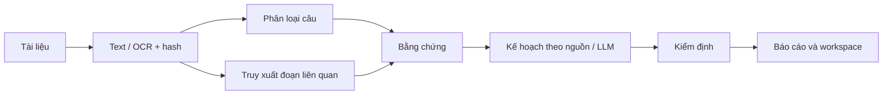

# Hướng dẫn demo và thuyết trình PSAI

Thông điệp chính: PSAI biến tài liệu đề xuất thành thông tin và bản kế hoạch có dẫn chứng để người dùng kiểm tra. Dự án đã có luồng chạy cục bộ và extension; chất lượng nội dung đầu cuối vẫn cần đánh giá độc lập bằng người.

Đọc [README](../README.md) để chuẩn bị máy mới, [hướng dẫn review](REVIEW_GUIDE.md) để hiểu bằng chứng, và [README_PROJECT](../README_PROJECT.md) để chạy đầy đủ model. Các lệnh dưới đây chạy tại thư mục gốc dự án.

## 1. Chuẩn bị trước buổi trình bày

- Clone mã nguồn, chuẩn bị Python và chạy demo nhanh theo [README](../README.md). Dùng [examples/proposal.md](../examples/proposal.md) làm mẫu mặc định có thể chia sẻ.
- Nếu demo extension, cài từ [extension/psai/](../extension/psai/) bằng Load unpacked và làm theo [README_EXTENSION](../README_EXTENSION.md). Chạy backend, ghép token của phiên hiện tại rồi kiểm tra kết nối.
- Nếu demo full, cung cấp đủ ba checkpoint ensemble, BGE-M3 và Qwen cục bộ; chuẩn bị dependency và thử trước trên chính máy trình bày. Giữ lại output thành công để mở khi cần giải thích hoặc đối chiếu với lượt live.
- Đọc mẫu đầu vào trước, chọn một mục tiêu, một yêu cầu và một hoạt động để đối chiếu trực tiếp trong báo cáo.
- Dùng thư mục output mới cho mỗi lượt. Không chỉnh dữ liệu/nhãn/manifest của study đã đóng băng để làm đẹp kết quả demo.

## 2. Kịch bản demo 5–10 phút

| Thời lượng | Thao tác | Điều cần giải thích |
|---|---|---|
| 0:00–1:00 | Mở [proposal.md](../examples/proposal.md), chỉ một yêu cầu và một hoạt động | Đầu vào là tài liệu đề xuất; đầu ra là thông tin và kế hoạch để người dùng kiểm tra |
| 1:00–2:30 | Chạy fast bằng CLI hoặc chọn Fast trong extension | Fast dùng rules + BM25 + kế hoạch theo nguồn; không có suy luận classifier/LLM học máy |
| 2:30–4:00 | Mở báo cáo của lượt vừa chạy, bấm một dẫn chứng | Câu chữ trở về đúng nguồn; vẫn cần đánh giá nhãn và ý nghĩa |
| 4:00–5:30 | Mở workspace, cập nhật một công việc/checklist, ghi chú, xuất JSON | Đây là tiến độ do người dùng cập nhật, không phải điểm chính xác model |
| 5:30–7:00 | Mở dữ liệu JSON hoặc log từ thư mục kết quả | Cho thấy chế độ chạy, nguồn/hash và các bước; đủ để reviewer tái hiện lỗi |
| 7:00–8:30 | Nếu đã chuẩn bị, mở kết quả full hoặc chạy full live | Full dùng ensemble → hybrid RAG → Qwen; nói rõ lượt nào chạy live và lượt nào đã tạo trước |
| 8:30–10:00 | Nêu kết quả nghiên cứu, giới hạn và trả lời một câu hỏi review | Phân biệt chức năng chạy được, điểm validation của từng study và chất lượng thực tế chưa được đo độc lập |

Nếu chỉ có 5 phút, dừng sau thao tác workspace rồi trình bày một câu về giới hạn; phần model và số liệu để ở slide dự phòng. Thời gian full tùy CPU/GPU, model và tài liệu; không hứa hoàn tất trong một khoảng cố định trên máy mới.

### Lệnh fast có thể chạy không cài thư viện ML

Với Python đã chuẩn bị theo README và đầu vào Markdown mẫu:

```powershell
python -m psai_project --input examples/proposal.md --output outputs/presentation_fast --classifier rules --retrieval bm25 --planner evidence --ocr none
```

Lệnh tạo `report.html`, `workspace.html`, `analysis.json` và log trong thư mục đầu ra được chỉ định. Mở file sau khi lệnh in thành công. Thư mục output phải chưa tồn tại; đổi tên khi chạy lại. Không dùng tốc độ hoặc kết quả fast để kết luận classifier đã train hoạt động tốt.

Có thể dùng launcher thuận tiện sau khi môi trường đã ổn định:

```powershell
python tools/demo_project.py --fast
```

[Launcher](../tools/demo_project.py) ưu tiên Python trong môi trường runtime riêng nếu có; lệnh `python -m psai_project` ở trên dùng đúng Python đang gọi.

### Lệnh full khi đã có model và dependency

```powershell
python tools/demo_project.py --input examples/proposal.md --device cuda --base-model-dir "D:/PSAI-models/BGE-M3/snapshots/5617a9f61b028005a4858fdac845db406aefb181" --planner-model-dir "D:/PSAI-models/Qwen"
```

Thay hai đường dẫn bằng model thật trên máy trình bày. GPU/CUDA phải phù hợp; có thể đổi `--device cpu` và thử trước, chấp nhận chạy chậm hơn. Ba checkpoint production cần đúng vị trí/config theo [README_PROJECT](../README_PROJECT.md) và [ensemble_classifier.py](../ensemble_classifier.py). GitHub chỉ cung cấp mã nguồn không có nghĩa máy nhận đã đủ weights. Mô hình Qwen được tích hợp cho suy luận; không trình bày như mô hình ngôn ngữ do dự án tự train.

Nếu full lỗi, mở log và dùng kết quả đã chạy trước có ghi rõ nguồn gốc. Chỉ chuyển sang demo fast sau khi nói rõ chế độ; không gọi nó là lượt full thành công.

## 3. Dàn ý 10 slide

| Slide | Nội dung trên slide | Hình hoặc bằng chứng nên đưa vào | Gợi ý lời nói |
|---|---|---|---|
| 1. Bài toán | Đọc đề xuất thủ công khó theo dõi mục tiêu, yêu cầu, hoạt động và sản phẩm | Một đoạn ngắn từ [proposal.md](../examples/proposal.md) | “Tôi muốn người dùng đi từ một tài liệu sang danh sách nội dung/công việc có thể kiểm tra lại.” |
| 2. Phạm vi sản phẩm | PDF/Markdown/TXT → báo cáo và workspace; CLI + extension | Giao diện extension hoặc báo cáo tạo từ máy trình bày | Phân biệt thao tác người dùng với chất lượng dự đoán; nêu backend chạy cục bộ |
| 3. Kiến trúc | Text/OCR → classifier; text → retrieval; bằng chứng → planner → kiểm định → đầu ra | Sơ đồ bên dưới hoặc [runtime](../psai_project/runtime.py) | Các model chạy tuần tự trong tiến trình riêng để không giữ đồng thời tất cả trên GPU |
| 4. Trích xuất và classifier | Năm nhãn, context và xác suất; production là ensemble ba checkpoint | [extraction.py](../extraction.py), [ensemble_classifier.py](../ensemble_classifier.py) | “Production ensemble và classifier nghiên cứu v2 là hai đối tượng khác nhau.” |
| 5. Retrieval và bằng chứng | BM25, dense BGE-M3, hybrid/RRF; tài nguyên tham khảo có nguồn riêng | Một kết quả truy xuất và dẫn chứng trong báo cáo | Quote/hash hỗ trợ truy vết; relevance vẫn cần người đánh giá |
| 6. Lập kế hoạch | Chọn/sắp xếp task có nguồn; kiểm tra schema, ID và chu trình | [planner README](../psai_planner/README.md) và một task trong workspace | Phụ thuộc, phân cấp và tài nguyên là đề xuất cần duyệt; không tự suy ra ngân sách/ngày cam kết |
| 7. Demo | Input → chạy → bấm nguồn → cập nhật tiến độ → xuất JSON | Lượt chạy thực tế hoặc ảnh/chụp của chính lượt chuẩn bị | Nói rõ fast hay full trước khi bắt đầu |
| 8. Kết quả và bằng chứng | Classifier v2 validation Macro-F1 0,632077; RAG delta nhỏ với CI chứa 0; nghiệm thu chức năng full đã có | [model card](../reports/classifier/release_source_clean_v2/model_card.md), [RAG report](../reports/rag_release_v1/BAO_CAO_RAG.md), [acceptance](../reports/project_completion/latest_acceptance.json) | Không gộp các số liệu thành accuracy toàn hệ thống; nói rõ validation và nhãn tự sinh |
| 9. Hạn chế | OCR tiếng Việt, sai nhãn/bỏ sót, query tự sinh, giới hạn token/catalog, môi trường/model lớn | Một ví dụ lỗi trong [phân tích classifier](../reports/classifier/release_source_clean_v2/PHAN_TICH_LOI.md) hoặc [báo cáo RAG](../reports/rag_release_v1/BAO_CAO_RAG.md) | Chọn lỗi có thật, không chỉ nêu hạn chế chung chung |
| 10. Hướng tiếp theo và trao đổi | Nhãn người độc lập; query thực; final test; cải thiện cài đặt/chuyển máy | Các câu hỏi trong [review guide](REVIEW_GUIDE.md) | Đề nghị reviewer kiểm tra khả năng chạy, độ đủ/đúng và khả năng tái hiện; không dùng final test để chọn model |

Để còn 8 slide, ghép slide 4–5 và 9–10. Giữ slide kết quả cùng phạm vi kết luận thay vì bỏ phần giới hạn.



## 4. Các câu trả lời cần chuẩn bị

**Dự án chính xác bao nhiêu phần trăm?** Chưa có một con số accuracy độc lập của toàn hệ thống. Classifier nghiên cứu v2 có validation Macro-F1 0,632077 và accuracy 0,760061 trên 1.317 câu theo [model card](../reports/classifier/release_source_clean_v2/model_card.md). Đây không phải điểm của production ensemble, PDF/OCR, RAG hoặc bản kế hoạch cuối.

**LoRA có giúp retrieval tốt hơn không?** Trong study tự sinh, dense within-document MRR@10 tăng từ 0,5053 lên 0,5066; delta +0,001286 và CI95% [-0,001667; +0,004365] chứa 0. Chưa đủ bằng chứng cải thiện ổn định, theo [báo cáo RAG](../reports/rag_release_v1/BAO_CAO_RAG.md). Runtime giữ base làm mặc định.

**Có chạy model thật chưa?** [Biên bản nghiệm thu](../reports/project_completion/latest_acceptance.json) ghi một fixture PDF tự tạo đã đi qua OCR, ensemble, retrieval và LLM trên máy được kiểm tra; nguồn/span/link được đối chiếu. Cũng chính biên bản ghi chưa đo research accuracy hoặc xác minh nhãn người. Muốn khẳng định chạy trên máy bạn cần chạy lại với đủ model/dependency.

**Có thể đọc PDF tiếng Việt hoặc scan bất kỳ không?** Không thể suy từ một fixture thành chất lượng trên mọi PDF. Đọc [OCR README](../psai_ocr/README.md): bố cục, ảnh và bảng cần đối chiếu; backend Windows đã kiểm tra dùng en-US và chưa có đánh giá OCR tiếng Việt độc lập.

**Có nguồn thì kế hoạch đã đúng chưa?** Nguồn chứng minh câu chữ được trích từ đâu. Nhãn, bỏ sót công việc, quan hệ phụ thuộc và cách gắn tài nguyên vẫn cần người duyệt, như [planner README](../psai_planner/README.md) nêu.

**Bạn nhận repo có chạy được ngay không?** Có thể chạy mẫu Markdown ở chế độ fast bằng Python theo [README](../README.md). Full cần cài dependency và cung cấp model riêng; hướng dẫn phải được thử trên máy nhận trước buổi thuyết trình.

## 5. Ghi lại buổi demo để reviewer tái hiện

Ghi commit, Python/môi trường, lệnh, chế độ fast/full, input và vị trí output mới. Khi trình bày kết quả tạo trước, ghi rõ đó là lượt chuẩn bị và môi trường của lượt đó. Dùng những tài liệu được phép chia sẻ; không đưa token ghép nối hoặc API key lên slide/GitHub. Những số liệu lịch sử không được gán lại cho phiên bản đang demo.
