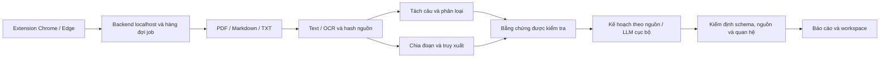

# Hướng dẫn đọc, chạy và đánh giá PSAI

PSAI phân tích tài liệu đề xuất dự án, phân loại câu, tìm đoạn bằng chứng và tạo bản kế hoạch có thể truy ngược về nguồn. Tài liệu này dành cho người nhận mã nguồn để xem xét cách triển khai và phạm vi các kết quả đã có.

## 1. Bắt đầu từ đâu?

1. Đọc [README](../README.md) để cài đặt trên máy mới và chạy demo nhanh.
2. Đọc [luồng toàn dự án](../README_PROJECT.md) để hiểu đầu vào, đầu ra và điều kiện chạy model đầy đủ.
3. Đọc [hướng dẫn extension](../README_EXTENSION.md) nếu muốn thao tác bằng Chrome/Edge.
4. Chạy ví dụ [proposal.md](../examples/proposal.md), mở báo cáo được tạo rồi đối chiếu một đoạn trích với tài liệu đầu vào.
5. Đọc code theo bảng ở phần 3; đọc bằng chứng nghiên cứu ở phần 4 trước khi nhận xét về độ chính xác.

Không cần bắt đầu bằng các script train hoặc đọc toàn bộ báo cáo lịch sử. Các thư mục kết quả trên máy tác giả có thể không được đưa lên GitHub; hãy dùng lệnh tái tạo trong README để có kết quả của máy mình.

## 2. Hai mức chạy và tiêu chí kiểm tra

### Demo nhanh từ bản clone

Sau khi chuẩn bị Python theo [README](../README.md), chạy trong thư mục gốc dự án:

```powershell
python -m psai_project --input examples/proposal.md --output outputs/review_fast --classifier rules --retrieval bm25 --planner evidence --ocr none
```

Với mẫu Markdown này, luồng nhanh không cần cài các thư viện ML, tải model, GPU hoặc API key. Nó dùng quy tắc phân loại, BM25 và kế hoạch theo bằng chứng. Đây là kiểm tra khả năng chạy và giao thức nguồn; không thể dùng kết quả này để đo hiệu quả của classifier đã train hoặc LLM.

Thư mục đầu ra phải chưa tồn tại. Khi chạy lại, đổi `outputs/review_fast` thành tên mới. Sau khi lệnh thành công:

- Mở `report.html` trong thư mục kết quả vừa tạo, bấm dẫn chứng và đối chiếu đoạn nguồn.
- Mở `workspace.html`, đổi trạng thái một công việc, ghi chú và xuất JSON tiến độ.
- Xem `analysis.json` và thư mục `jobs` để đối chiếu request/response, chế độ chạy và nguồn.
- Nếu đưa vào tài liệu mới, kiểm tra nội dung có bị bỏ sót hoặc gắn sai nhãn; việc đoạn trích khớp nguồn không chứng minh ý nghĩa đã đúng.

Tên đầu ra ở trên chỉ là vị trí được lệnh tạo mới; các file kết quả không có sẵn trong bản clone.

### Chạy đầy đủ model cục bộ

Theo [README_PROJECT](../README_PROJECT.md) và phần dependency/model trong [README](../README.md), chuẩn bị môi trường ML và cung cấp model riêng. Bản clone mã nguồn không tự chứa weights, cache model hoặc môi trường của tác giả.

```powershell
python tools/demo_project.py --input examples/proposal.md --device cpu --base-model-dir "D:/PSAI-models/BGE-M3/snapshots/5617a9f61b028005a4858fdac845db406aefb181" --planner-model-dir "D:/PSAI-models/Qwen"
```

Các đường dẫn `D:/PSAI-models/...` là ví dụ; thay bằng thư mục model thật trên máy nhận. CPU có thể chậm; dùng `--device cuda` khi đã cài PyTorch/CUDA phù hợp và có GPU tương thích. Cần đủ cả ba checkpoint production `final_s11`, `final_s22`, `final_s33` theo [ensemble_classifier.py](../ensemble_classifier.py), cùng BGE-M3 và causal-LM cục bộ. Mỗi export phải có weights, config và tokenizer; classifier cần inference config tương ứng. Adapter LoRA không thay thế model BGE-M3 gốc. Không lấy manifest đường dẫn máy tác giả làm bằng chứng model đã có trên máy nhận.

Full chạy ensemble → hybrid retrieval → local LLM trong các tiến trình tuần tự. Lệnh không train hoặc tự tải model. Nếu thiếu tài nguyên hoặc JSON do LLM sinh không hợp lệ, cần xem lỗi và log; không ghi nhận full đã đạt chỉ vì fast chạy được. Chi tiết kiểm tra môi trường và điều kiện PDF/OCR ở [README_PROJECT](../README_PROJECT.md).

## 3. Kiến trúc và thứ tự đọc code



| Câu hỏi khi đọc | Điểm vào |
|---|---|
| Lệnh demo chọn chế độ và gọi pipeline thế nào? | [tools/demo_project.py](../tools/demo_project.py), [psai_project/__main__.py](../psai_project/__main__.py) |
| Thứ tự chạy, lỗi và giải phóng model giữa các bước? | [psai_project/runtime.py](../psai_project/runtime.py), [worker.py](../psai_project/worker.py) |
| Văn bản PDF/OCR được tạo và ràng buộc với nguồn ra sao? | [pdf_preprocessing.py](../pdf_preprocessing.py), [psai_ocr/README.md](../psai_ocr/README.md) |
| Tách câu, context, nhãn và bằng chứng? | [extraction.py](../extraction.py), [ensemble_classifier.py](../ensemble_classifier.py) |
| Quy tắc kế hoạch và suy luận LLM khác nhau ở đâu? | [planning.py](../planning.py), [psai_planner/README.md](../psai_planner/README.md) |
| BM25/dense/hybrid, index và kiểm tra hash? | [psai_retrieval/README.md](../psai_retrieval/README.md), [README_RAG.md](../README_RAG.md) |
| Giao diện extension gửi tài liệu đến backend thế nào? | [extension/psai/](../extension/psai/), [psai_extension/server.py](../psai_extension/server.py) |
| Báo cáo và tiến độ người dùng được xuất thế nào? | [psai_project/report.py](../psai_project/report.py), [workspace.py](../psai_project/workspace.py) |
| Nhánh classifier nghiên cứu được chọn và đóng băng ra sao? | [README_CLASSIFIER.md](../README_CLASSIFIER.md), [model card v2](../reports/classifier/release_source_clean_v2/model_card.md) |

Hash và char spans giúp xác minh xuất xứ câu chữ. Vị trí ký tự thuộc văn bản đã trích, không phải tọa độ trực tiếp trên trang PDF. Tiến độ trong workspace là tiến độ công việc do người dùng cập nhật; nó không biểu thị chất lượng model.

## 4. Đọc kết quả đúng phạm vi

| Đối tượng | Bằng chứng hiện có | Kết luận được phép |
|---|---|---|
| Pipeline đầy đủ | [latest_acceptance.json](../reports/project_completion/latest_acceptance.json): fixture tự tạo, các bước model chạy thành công, hash/span/link được kiểm tra | Luồng chức năng đã chạy trên môi trường được ghi nhận; không phải đánh giá accuracy đầu cuối |
| Classifier production | [ensemble_classifier.py](../ensemble_classifier.py): `final_s11` + `final_s22` + `final_s33` | Đây là ensemble được gọi trong chế độ full; không tự gán điểm của checkpoint nghiên cứu v2 cho ensemble |
| Classifier nghiên cứu v2 | [model card](../reports/classifier/release_source_clean_v2/model_card.md): baseline seed 2026, validation 1.317 câu, Macro-F1 0,632077, accuracy 0,760061 | Điểm validation phát triển sau loại trùng toàn nguồn; chưa có final test độc lập hoặc kết luận vượt ensemble |
| RAG study | [báo cáo RAG](../reports/rag_release_v1/BAO_CAO_RAG.md): 54 query tự sinh/22 nhóm nguồn; dense within-document MRR@10 base 0,5053, LoRA 0,5066 | Delta +0,001286, CI95% [-0,001667; +0,004365] chứa 0; chưa đủ bằng chứng LoRA cải thiện ổn định |
| LLM kế hoạch | [giao thức planner](../psai_planner/README.md): chọn/sắp xếp task có nguồn, kiểm tra schema và quan hệ | Có cơ chế hạn chế nội dung không được hỗ trợ; chưa chứng nhận kế hoạch đúng và đầy đủ bằng người đánh giá độc lập |

[Biên bản nghiệm thu](../reports/project_completion/latest_acceptance.json) ghi rõ `research_accuracy_measured=false` và `human_label_quality_verified=false`. Không đổi các trạng thái này thành khẳng định chất lượng nghiên cứu. Các số test trong báo cáo cũ là bằng chứng của lần chạy được ghi ở đó; muốn kết luận trên phiên bản đang review phải chạy kiểm tra tương ứng và lưu môi trường/kết quả mới.

Những báo cáo classifier v1, seed khác hoặc nghiên cứu context khác được giữ để truy vết lịch sử. Kết quả v1 0,654426 không thuộc checkpoint v2 0,632077. Nhãn AI đề xuất không trở thành nhãn chuẩn do xuất hiện trong báo cáo. Query/positive tự sinh của RAG cũng chưa phải relevance do người kiểm định. Chưa có một con số accuracy độc lập đại diện cả OCR, phân loại, retrieval và lập kế hoạch.

## 5. Những giới hạn cần kiểm tra trực tiếp

- **PDF/OCR:** thứ tự đọc, bảng, hình, trang scan và tài liệu trộn text/ảnh có thể mất thông tin. Backend Windows OCR được kiểm tra dùng en-US; chưa có chứng nhận chất lượng OCR tiếng Việt. Xem [OCR](../psai_ocr/README.md).
- **Classifier:** năm nhãn là OBJECTIVE, REQUIREMENT, ACTIVITY, EXPECTED_RESULT, OTHER. Xác suất softmax không phải xác suất đúng đã hiệu chuẩn. Nguồn/nhãn người và near-duplicate còn cần đánh giá độc lập theo [model card](../reports/classifier/release_source_clean_v2/model_card.md).
- **Retrieval:** query validation tự sinh, teacher hướng tiếng Anh và khác biệt chia đoạn giữa study/runtime hạn chế khả năng suy rộng. Default dense giữ base; LoRA là tùy chọn nghiên cứu. Xem [báo cáo RAG](../reports/rag_release_v1/BAO_CAO_RAG.md).
- **LLM:** mặc định tối đa 3.072 token đầu vào, 1.024 token đầu ra và catalog 12 công việc. Có thể còn công việc ngoài catalog; phụ thuộc, phân cấp và gắn tài nguyên cần người duyệt. Xem [planner](../psai_planner/README.md).
- **Chuyển máy:** Python/dependency, GPU và đường dẫn model có thể khác. Full chạy trên máy tác giả không tự bảo đảm clone mới có đủ model; ưu tiên kiểm chứng fast trước theo [README](../README.md).

## 6. Câu hỏi cho người review

1. Sau clone, có chạy được ví dụ từ README bằng môi trường mới? Lỗi có hướng dẫn rõ thiếu dependency/model nào?
2. Có theo được một đoạn từ tài liệu → bằng chứng → công việc → dẫn chứng trong báo cáo không?
3. Nội dung nào bị bỏ sót, sai nhãn hoặc không thực sự hỗ trợ công việc được gắn vào? Ghi nguyên văn đoạn nguồn và kết quả mong đợi.
4. Tài nguyên tham khảo có bị biến nhầm thành yêu cầu bắt buộc của dự án?
5. Đầu ra sai schema, nguồn bị sửa, thiếu model hoặc PDF không đọc được có báo lỗi rõ và giữ chẩn đoán?
6. Code, manifest, checkpoint và số liệu trình bày có nói về cùng một phiên bản? Có trộn validation với final test không?
7. Với tài liệu mới, cần người có chuyên môn kiểm định nhãn, relevance và độ đủ/đúng của kế hoạch theo quy trình nào?

Khi gửi nhận xét, ghi commit đang xem, phiên bản Python, chế độ fast/full, lệnh đã chạy, đầu vào có thể chia sẻ, lỗi thực tế và kết quả mong đợi. Giữ token ghép nối/API key và tài liệu riêng tư ngoài issue. Người review có thể dùng [hướng dẫn thuyết trình](PRESENTATION_GUIDE.md) để chuẩn bị buổi trao đổi sau khi chạy thử.
